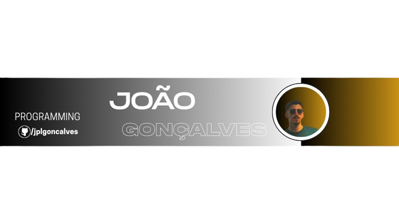

  <!-- Cabeçalho Dark & Green -->
  

  <h1>Olá, eu sou o João Gonçalves! </h1>

  

    <strong>Criador da Snakened e programador do Gonix Micro OS</strong>
  

  

    🇵🇹 Portugal · 💻 Desenvolvimento de Software · 🌐 Open Source
  

  

    
    
    
  

---

## 👨‍💻 Sobre mim

Sou um programador de software independente de Portugal, interessado na criação de linguagens de programação, sistemas operativos e aplicações.

Desenvolvo projetos próprios com o objetivo de explorar novas ideias, aprofundar conhecimentos técnicos e contribuir para o ecossistema tecnológico.

- 🐍 Criador da linguagem de programação **Snakened**.
- ⚙️ Desenvolvedor do projeto **Gonix Micro OS**.
- 📚 Criador de projetos educativos e plataformas digitais.
- 🔐 Interessado em cibersegurança, redes informáticas e sistemas.
- 🌍 Aberto a sugestões, feedback técnico e colaboração em projetos open source.

---

  

---

## 🚀 Projetos em destaque

<table>
  <tr>
    <td width="33%" valign="top">
      <h3 align="center">🐍 Snakened</h3>
      
<strong>Linguagem de programação</strong>

      
Uma linguagem de programação independente, desenvolvida no âmbito dos meus projetos pessoais, com foco na sintaxe, na execução de código e nas ferramentas de desenvolvimento.

      

        
      

    </td>
    <td width="33%" valign="top">
      <h3 align="center">⚙️ Gonix Micro OS</h3>
      
<strong>Sistemas operativos</strong>

      
Um projeto de sistema operativo independente, orientado para a exploração da arquitetura de sistemas, programação de baixo nível e funcionamento de um sistema operativo.

      

        
      

    </td>
    <td width="33%" valign="top">
      <h3 align="center">📚 AprenderMais</h3>
      
<strong>Educação digital</strong>

      
Uma plataforma educativa orientada para a organização de conteúdos por etapas de ensino e disciplinas, tendo como referência o currículo português.

      

        
      

    </td>
  </tr>
</table>

  <a href="https://github.com/jplgoncalves?tab=repositories">
    <strong>Ver todos os meus repositórios →</strong>
  </a>

---

## 🛠️ Tecnologias e ferramentas

### 💻 Linguagens de programação

  
  
  
  
  
  
  
  
  
  
  
  
  

### 🌐 Desenvolvimento web e bases de dados

  
  
  
  
  
  
  

### ⚙️ Sistemas operativos e ferramentas

  
  
  
  
  
  
  
  

---

## 🎯 Áreas de interesse

- Desenvolvimento de linguagens de programação.
- Arquitetura e desenvolvimento de sistemas operativos.
- Programação de baixo nível.
- Cibersegurança e redes informáticas.
- Software educativo e plataformas de conhecimento.
- Software livre e colaboração entre programadores.

---

## 🤝 Colaboração e comunidade

Acredito que o desenvolvimento de software melhora com a partilha de conhecimento, a experimentação e o feedback construtivo.

Se algum dos meus projetos te interessar, podes:

- ⭐ Dar uma estrela aos repositórios que consideres úteis.
- 🐛 Reportar problemas através de Issues.
- 💡 Propor funcionalidades e melhorias.
- 🔧 Contribuir com código, documentação ou testes.
- 💬 Partilhar sugestões e ideias.

Todas as contribuições construtivas são bem-vindas, de acordo com as regras e licenças de cada projeto.

---

## 📊 Atividade no GitHub

  

  

---

  <h3>Obrigado por visitares o meu perfil! 🇵🇹</h3>

  
<i>Construindo o futuro, linha por linha.</i>

  

